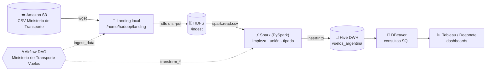
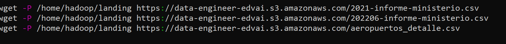
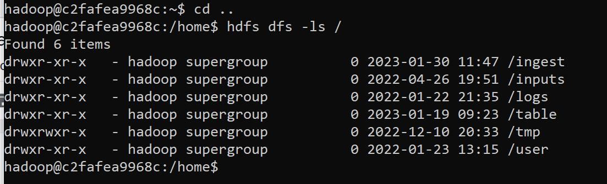
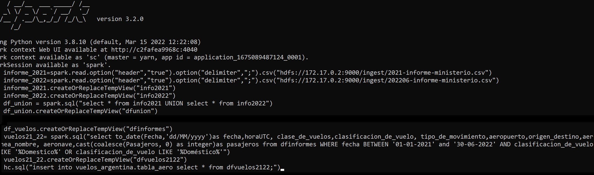
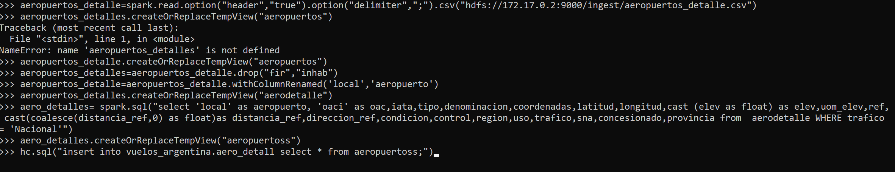
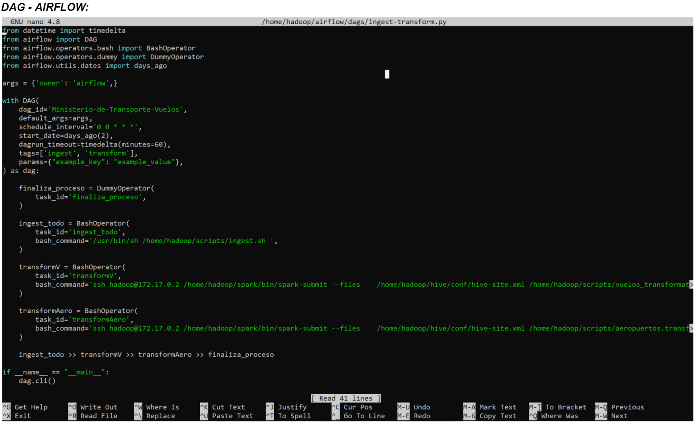
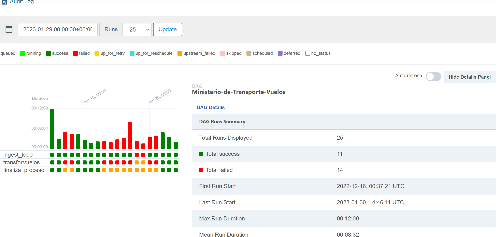
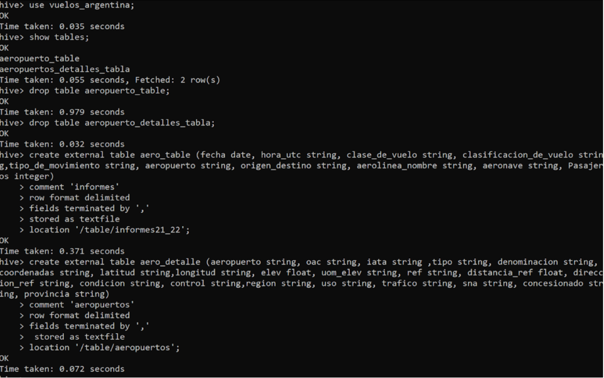
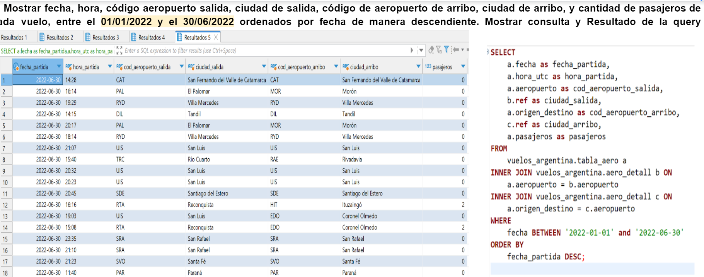

# ✈️ Pipeline ETL de Vuelos Domésticos de Argentina

[](https://github.com/Jeanette22/pipelines_datos_vuelos-ETL/actions/workflows/ci.yml)


Pipeline de datos **batch** que ingiere los informes de vuelos 2021–2022 del Ministerio de Transporte de Argentina, los transforma con **Spark**, los carga en un Data Warehouse en **Hive** y se orquesta con **Airflow**. Sobre esas tablas se resuelven consultas de negocio en SQL (DBeaver) y se publican dashboards.

---

## Tabla de contenidos

1. [Descripción técnica](#-descripción-técnica)
2. [Arquitectura](#-arquitectura)
3. [Estructura del repositorio](#-estructura-del-repositorio)
4. [Puesta en marcha](#-puesta-en-marcha)
5. [Tests](#-tests)
6. [Consultas y resultados](#-consultas-y-resultados)
7. [Cómo contribuir](#-cómo-contribuir)
8. [Autora](#-autora)

---

## 📌 Descripción técnica

**Propósito.** Dejar datos de vuelos limpios, tipados y consultables con SQL para responder preguntas de negocio (volumen de vuelos, pasajeros por aerolínea, aeronaves más usadas, rutas).

**Origen de datos.** Archivos CSV (separador `;`) de [Datos Abiertos – Ministerio de Transporte](https://datos.gob.ar/), alojados en un bucket de Amazon S3:

| Archivo | Contenido |
|---|---|
| `2021-informe-ministerio.csv` | Vuelos 2021 |
| `202206-informe-ministerio.csv` | Vuelos 2022 (hasta junio) |
| `aeropuertos_detalle.csv` | Catálogo de aeropuertos (código, ciudad, provincia, tráfico, etc.) |

**Transformaciones (Spark / PySpark).**

| Dataset | Transformación |
|---|---|
| Vuelos | Unión de los informes 2021 y 2022 sin duplicados |
| Vuelos | Normalización de encabezados a `snake_case` sin tildes (`Hora UTC` → `hora_utc`) |
| Vuelos | `fecha` de texto `dd/MM/yyyy` a tipo `date` |
| Vuelos | Filtro de **vuelos domésticos** entre `2021-01-01` y `2022-06-30` |
| Vuelos | `pasajeros` a `int`, con nulos reemplazados por `0` |
| Aeropuertos | Se descartan las columnas `fir` e `inhab`; `local` → `aeropuerto`, `oaci` → `oac` |
| Aeropuertos | `elev` y `distancia_ref` a `float` (nulos de distancia → `0`) |
| Aeropuertos | Filtro de tráfico **Nacional** |

**Destino.** Base Hive `vuelos_argentina` con dos tablas externas:

- `tabla_aero` — vuelos (`fecha`, `hora_utc`, `clase_de_vuelo`, `clasificacion_de_vuelo`, `tipo_de_movimiento`, `aeropuerto`, `origen_destino`, `aerolinea_nombre`, `aeronave`, `pasajeros`)
- `aero_detall` — aeropuertos (21 columnas, ver [`sql/01_create_tables.hql`](sql/01_create_tables.hql))

**Orquestación.** Un DAG de Airflow (`Ministerio-de-Transporte-Vuelos`) ejecuta diariamente: ingesta → transformación de vuelos → transformación de aeropuertos → fin.

**Idempotencia.** La ingesta pisa los archivos (`wget -O`, `hdfs dfs -put -f`) y la carga usa `overwrite`, por lo que re-ejecutar el DAG no duplica datos.

---

## 🏗️ Arquitectura



**Flujo del DAG:**


> Las tareas de transformación corren en secuencia a propósito: con el metastore Derby embebido de Hive, dos `spark-submit` simultáneos se bloquean entre sí.

<details>
<summary>📸 Capturas del proyecto original (evidencia de ejecución)</summary>

| Etapa | Captura |
|---|---|
| Descarga de datasets |  |
| Archivos en HDFS |  |
| Transformación de vuelos |  |
| Transformación de aeropuertos |  |
| DAG en Airflow |  |
| Ejecución en Airflow |  |
| Tablas en Hive |  |
| Consulta con JOIN en DBeaver |  |

</details>

---

## 📂 Estructura del repositorio

```
pipelines_datos_vuelos-ETL/
├── README.md
├── LICENSE
├── .env.example               # plantilla de configuración (copiar a .env)
├── .gitignore
├── requirements.txt           # dependencias de ejecución
├── requirements-dev.txt       # + pytest y ruff
├── pyproject.toml
├── .github/workflows/ci.yml   # lint + tests en cada push/PR
├── dags/
│   └── ministerio_transporte_vuelos.py   # DAG de Airflow
├── scripts/
│   ├── ingest.sh              # S3 -> landing -> HDFS
│   ├── transform_vuelos.py    # entrypoint spark-submit (vuelos)
│   └── transform_aeropuertos.py          # entrypoint spark-submit (aeropuertos)
├── src/vuelos_etl/
│   ├── config.py              # configuración por variables de entorno
│   ├── spark_session.py       # SparkSession con soporte Hive
│   ├── transformations.py     # funciones puras DataFrame -> DataFrame
│   └── pipelines.py           # lectura HDFS + escritura Hive
├── sql/
│   ├── 01_create_tables.hql   # DDL de las tablas Hive
│   └── 02_consultas.sql       # consultas de análisis
├── tests/                     # pytest con Spark local
└── docs/images/               # capturas de la ejecución original
```

---

## 🚀 Puesta en marcha

### Requisitos

- Un entorno con **Hadoop (HDFS)**, **Spark 3.2+**, **Hive** y **Airflow 2.4+**. En el proyecto original se usó un contenedor **Docker** con todo el stack.
- Python 3.8+ y Java 8/11/17 (para PySpark).

### 1. Clonar e instalar

```bash
git clone https://github.com/Jeanette22/pipelines_datos_vuelos-ETL.git
cd pipelines_datos_vuelos-ETL

python -m venv .venv
source .venv/bin/activate          # Windows: .venv\Scripts\activate
pip install -r requirements.txt
```

### 2. Configurar variables de entorno

```bash
cp .env.example .env
# Editá .env: HDFS_NAMENODE, rutas, etc.
```

> `.env` está en `.gitignore`: no subas credenciales ni IPs al repositorio.

### 3. Crear las tablas en Hive (una sola vez)

```bash
hive -f sql/01_create_tables.hql
```

### 4. Ejecutar el pipeline manualmente

```bash
# Ingesta: S3 -> landing -> HDFS
bash scripts/ingest.sh

# Transformación y carga en Hive
spark-submit --files "$HIVE_CONF_DIR/hive-site.xml" scripts/transform_vuelos.py
spark-submit --files "$HIVE_CONF_DIR/hive-site.xml" scripts/transform_aeropuertos.py
```

Verificá la carga:

```sql
SELECT COUNT(*) FROM vuelos_argentina.tabla_aero;
SELECT COUNT(*) FROM vuelos_argentina.aero_detall;
```

### 5. Ejecutar con Airflow (automatizado)

```bash
cp dags/ministerio_transporte_vuelos.py "$AIRFLOW_HOME/dags/"
# Definí en el entorno del scheduler: ETL_REPO_DIR, SPARK_SUBMIT_BIN, HIVE_SITE_XML
# (y SPARK_SSH_TARGET si Spark está en otro nodo). Ver .env.example
airflow dags unpause Ministerio-de-Transporte-Vuelos
airflow dags trigger Ministerio-de-Transporte-Vuelos
```

---

## 🧪 Tests

Las transformaciones están separadas de la E/S, así que se prueban con Spark local y datos de ejemplo:

```bash
pip install -r requirements-dev.txt
ruff check src scripts tests
pytest -v
```

---

## 📈 Consultas y resultados

Las consultas están en [`sql/02_consultas.sql`](sql/02_consultas.sql). Resultados del informe original (2021 – junio 2022):

| Pregunta | Resultado |
|---|---|
| Vuelos entre 01/12/2021 y 31/01/2022 | **56.163** |
| Pasajeros de Aerolíneas Argentinas (01/01/2021 – 30/06/2022) | **7.262.042** |
| Top aerolíneas por pasajeros | 1. Aerolíneas Argentinas (7.262.042) · 2. JetSmart (1.466.020) · 3. Flybondi (1.436.491) |
| Aeronaves más usadas desde Buenos Aires / CABA | CE-150-L · CE-152 · CE-150-M … |

**Dashboards:** [Tableau](https://public.tableau.com/app/profile/jeanettecrd/viz/MinisteriodeTransporte-Vuelos2021-2022/Dashboard1) · [Deepnote](https://deepnote.com/workspace/jeanette-mansilla22crd-63c0520f-11c5-4cfb-8954-72e145bb64e1/project/Ministerio-de-Transporte-vuelos-aeropuertos-77e97841-83b8-4421-98eb-4892caab8e33/notebook/Vuelos%202021-2022%20Argentina-8b8608e79aba42b382b5ab507a4b7e81)

**Ideas de análisis futuro:** experiencia de usuario, marketing y servicio al cliente, proyecciones de presupuesto.

---

## 🤝 Cómo contribuir

¡Las contribuciones son bienvenidas! Este proyecto nació como guía de aprendizaje, así que sugerencias y correcciones suman mucho.

1. **Hacé un fork** del repositorio (botón *Fork* arriba a la derecha).
2. **Cloná tu fork** y creá una rama descriptiva:
   ```bash
   git clone https://github.com/<tu-usuario>/pipelines_datos_vuelos-ETL.git
   cd pipelines_datos_vuelos-ETL
   git checkout -b feat/mi-mejora
   ```
3. **Instalá las dependencias de desarrollo** y asegurate de que todo pase:
   ```bash
   pip install -r requirements-dev.txt
   ruff check src scripts tests && pytest
   ```
4. **Hacé commits pequeños y claros** (ej.: `feat: agrega validación de nulos en aeropuertos`).
5. **Subí tu rama** y abrí un **Pull Request** hacia `main`, explicando qué cambia y por qué.
6. Si encontrás un error o tenés una idea, abrí un **Issue** antes de empezar.

**Ideas para colaborar:** `docker-compose` para levantar el stack completo, validaciones de calidad de datos, formato Parquet, más tests, tablero actualizado.

---

## 👩‍💻 Autora

**Jeanette Mansilla** — [Portfolio](https://jeanettemansilla.netlify.app/) · [LinkedIn](https://www.linkedin.com/in/jeanettemansilla/) · [Tableau Public](https://public.tableau.com/app/profile/jeanettecrd/vizzes)

Distribuido bajo licencia MIT. Ver [`LICENSE`](LICENSE).
